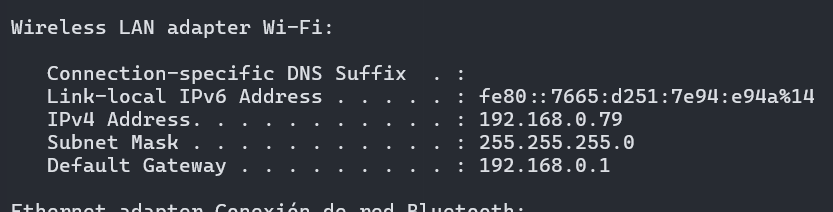
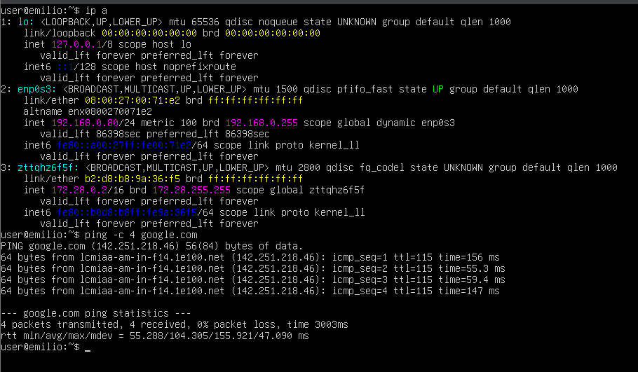
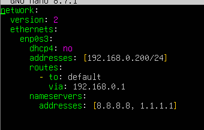
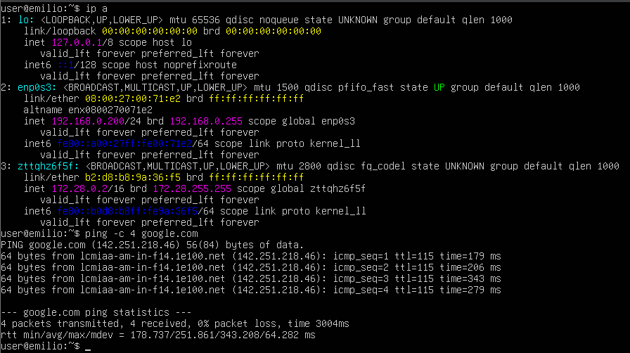
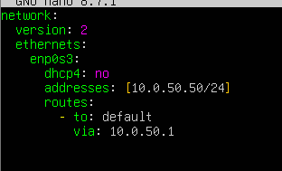
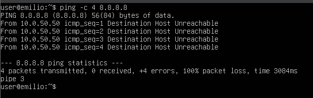

# Tarea 03 - Modos de red VMs

- Subred del hipervisor

### Escenario 1
- Ping a google.com

### Escenario 2
- Configuración de conexión a la red

- Ping

### Escenario 3
- Configuración

- ping
